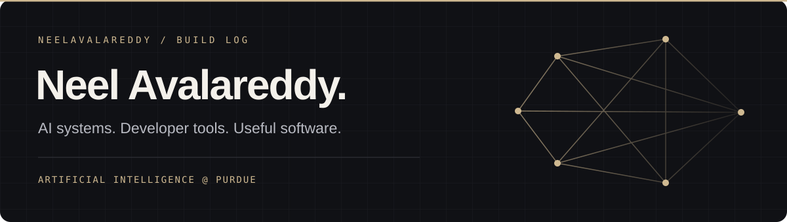

  

I study **Artificial Intelligence at Purdue** and build tools for coding agents, AI evaluation, workflow automation, and quantitative research.

### Selected builds

<table>
<tr>
<td width="50%" valign="top">
<h3><a href="https://github.com/auto-skill/auto-skill-connector">01 / Auto-Skill ↗</a></h3>

<strong>The right skill, at the right time.</strong>

Founded and built a task-aware skill router for coding agents. Delivers relevant techniques through MCP and CLI integrations for Claude Code, Codex, Cursor, and GitHub Copilot.

Python · FastAPI · SQLite · MCP · Agent tooling

</td>
<td width="50%" valign="top">
<h3>02 / Classify</h3>

<strong>Human judgment meets AI evaluation.</strong>

A human-in-the-loop AI evaluation marketplace with a two-stage LLM judge pipeline and real-time agent chat.

Next.js · TypeScript · Supabase · World ID · LLM evaluation

</td>
</tr>
<tr>
<td width="50%" valign="top">
<h3>03 / Kova</h3>

<strong>AI automation for real business workflows.</strong>

Co-founded an AI automation consultancy and built its website, outreach pipelines, and client automations.

<a href="https://github.com/neelavalareddy/outreach-pipeline">Explore the outreach pipeline ↗</a>

Next.js · TypeScript · Workflow automation

</td>
<td width="50%" valign="top">
<h3><a href="https://github.com/neelavalareddy/trade">04 / AlphaFactor ↗</a></h3>

<strong>Factor research with risk controls built in.</strong>

A multi-factor equity paper-trading system with volatility-based position sizing, drawdown circuit breakers, scheduled rebalancing, and a portfolio monitoring dashboard.

Python · Alpaca · Flask · SEC EDGAR · Portfolio risk

</td>
</tr>
</table>

### Tools I work with

**Python · TypeScript · JavaScript · C · React · SQL**

MCP and agent tooling · LLM evaluation · Retrieval systems · Full-stack development
